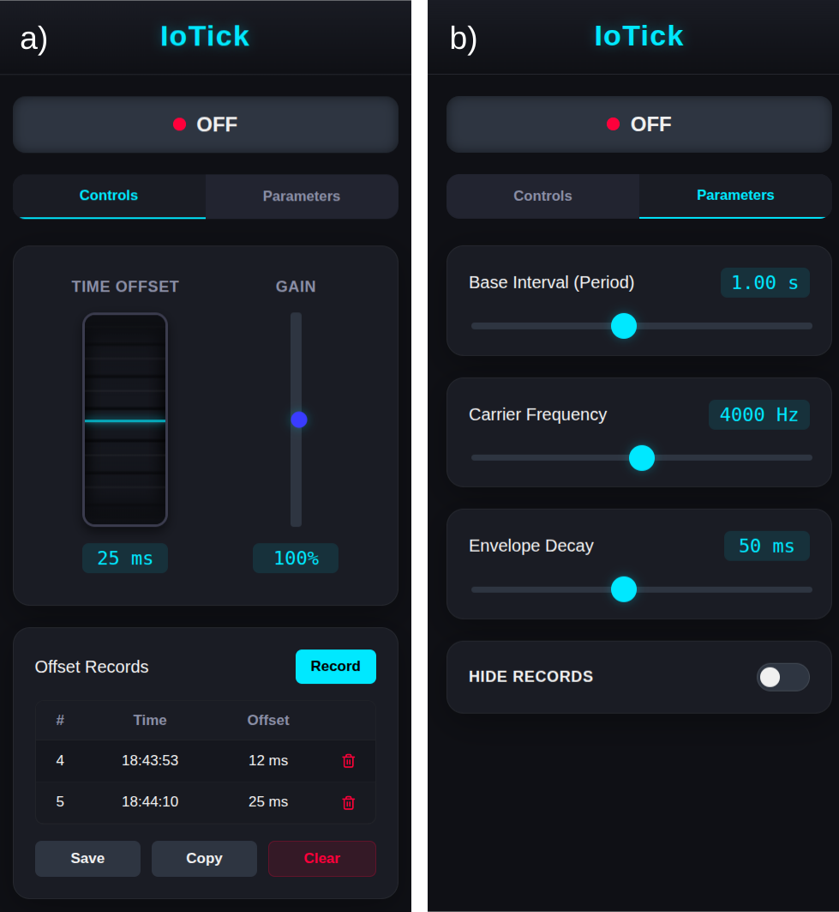

# *IoTick* Web Application

*Acoustic pulse generator and phase-delay controller for auditory timing experiments*

---

### System Architecture

- **Software type:** Progressive Web Application (PWA)
- **Operating mode:** 100% client-side, fully offline once loaded
- **Audio engine:** Native Web Audio API

### Compatibility & Context

- **Platforms:** tested on Android (Chrome) and expected to run in any modern browser with the Web Audio API (iOS Safari, desktop)
- **Hardware clock:** Sub-millisecond DAC scheduling precision
- **Companion paper:** *Rømer all ears*

---

## 1. Overview and Pedagogical Design Philosophy

The IoTick application is an open-source, client-side Progressive Web Application (PWA) developed to support the acoustic reproduction of Ole Rømer's method and the determination of the speed of sound via auditory coincidence. Rather than functioning as an automated measuring tool or a "black-box" sensor, IoTick acts strictly as a configurable pulse generator and phase-delay controller.

- **No black-box measurements:** The software does not calculate speeds, does not trigger internal microphones, and does not process external audio signals. The entire physical measurement – detecting temporal coincidence, perceiving timbre variations, and identifying delay – is performed exclusively by the human auditory system.
- **Universal cross-platform accessibility:** Operating directly within standard mobile browsers (such as Chrome, Safari, Firefox, and Edge), the application requires no installation through commercial app stores, no account creation, and no network connectivity once loaded.
- **Autonomous dual-clock emulation:** By operating on two independent smartphones without Wi-Fi, Bluetooth, or cellular synchronization, the experimental setup authentically reproduces the epistemological conditions of Ole Rømer's 1676 astronomical discovery, in which two autonomous clocks (Io's orbital period and Earth's axial rotation) were compared across interplanetary distances.

## 2. Application Installation and Offline Setup

### 2.1 Loading and installing as a Progressive Web App (PWA)

1. **Initial loading:** Open the [*IoTick* URL](https://jocoteles.github.io/IoTick/) in your smartphone's web browser while connected to Wi-Fi or mobile data.
2. **Installing on iOS (Safari):**
   - Tap the ***Share*** button (square with an upward arrow) at the bottom of the screen.
   - Scroll down and select ***Add to Home Screen***.
   - Confirm by tapping ***Add***. An *IoTick* icon will appear on your home screen.
3. **Installing on Android (Chrome):**
   - Tap the ***Menu*** icon (three vertical dots) in the upper right corner.
   - Select ***Install app*** or ***Add to Home Screen***.
   - Confirm the prompt. The application is now installed as a standalone web app.
4. **Verifying offline operation:** Once loaded or installed on the home screen, enable ***Airplane Mode*** on both smartphones. Re-open *IoTick*. Thanks to its built-in Service Worker cache, the application opens and runs with complete functionality with no internet connection.

### 2.2 Preventive hardware configuration

> - **Disable battery-saving modes:** Low-power modes on mobile operating systems can throttle audio hardware or induce aggressive background process suspension.
> - **Keep the app in front:** *IoTick* keeps the screen on while playing in most browsers. As a fallback, set the screen timeout longer than a run (or "Never" during the class session). Do not switch apps or lock the screen during a run.
> - **Avoid interruptions:** Enable *Do Not Disturb* (in addition to *Airplane Mode*). Notifications, calls, or alarms can pause the audio, after which the pulse train resumes shifted in time. Checking that the pulses still coincide when back at the starting point reveals any such shift.
> - **Volume configuration:** Turn the media volume on both devices close to maximum (≈ 90% to 100%). Because the handheld phone stays near the ear, start with its *Gain* low and raise it gradually. Never hold it against the ear at full volume.
> - **Clear background tasks:** Close extraneous applications running in the background to free memory.

## 3. User Interface and Control Reference

**Figure 1:** User interface of the *IoTick* web application, divided into two primary tabs: (a) the ***Controls*** tab (used actively during experimental data collection) for *Time Offset* drum-wheel tuning, *Gain* matching, and logging in *Offset Records* (shown here with blind mode disabled), and (b) the ***Parameters*** tab (configured before starting) for configuring acoustic properties and enabling blind mode (*Hide Records*).

### 3.1 The Controls tab

The ***Controls*** tab (Fig 1a) contains all operational tools used during active data collection:

| Control | Description |
| :--- | :--- |
| **`ON/OFF`** | Starts and stops sound pulse emission. When active, the button highlights and indicates emission status. |
| **`Time Offset`** | A vertically rolling touch selector that adjusts the local relative delay *t* of the handheld phone in precise **1 ms steps**. The adjustment is cyclical modulo the base period (0 ≤ *t* < *T*). Rolling upward advances the phase and downward retards it. |
| **`Gain`** | A continuous vertical fader (0% to 200%, with 100% representing nominal unity gain) that scales the pulse volume. This allows the user to balance the apparent loudness of the sound against ambient noise or a second source. Alternatively, the smartphone's physical volume buttons can be used for the same purpose if found more ergonomic. |
| **`Record`** | Stores the entry index, local timestamp (in HH:MM:SS format), and current *Time Offset* reading in the internal session table. |
| **`Offset Records`** | Lists all recorded entries for the current session. When blind mode is active, numerical offset values remain hidden until data export. |
| **`Clear`** | Resets the session table before starting a new experimental session. |
| **`Save`** | Exports the recorded run as a comma-separated `.csv` spreadsheet file (revealing all hidden blind values). |
| **`Copy`** | Copies the formatted data table to the system clipboard for immediate pasting into other mobile tools. |

### 3.2 The Parameters tab

The ***Parameters*** tab (Fig 1b) sets the signal properties and operational modes:

| Parameter | Description |
| :--- | :--- |
| **`Base Interval` (*T*)** | Defines the repetition period between successive pulses. The default is *T* = 1.00 s (adjustable from 0.20 to 2.00 s). |
| **`Carrier Frequency` (*f*)** | Sets the pitch of the sinusoidal burst. The default is *f* = 4000 Hz (adjustable from 3000 to 5000 Hz). |
| **`Envelope Decay`** | Sets the exponential decay duration of each pulse (to −80 dB). The default is 50 ms (adjustable from 10 to 100 ms). |
| **`Hide Records` (Blind Mode)** | When enabled, the application masks all numerical offset readings from the main display and log table during data acquisition. |

## 4. Web Audio API Architecture and Timing Precision

In typical browser environments, standard JavaScript timing mechanisms such as `setTimeout()` and `setInterval()` run on the main user-interface thread. Under load or when redrawing graphical elements, these routines suffer from variable execution delays and queue latency, leading to timing fluctuations on the order of tens of milliseconds. Such fluctuations would completely obscure the millisecond-scale acoustic delays investigated in this laboratory reproduction of Rømer's method.

To overcome this fundamental limitation, *IoTick* is built on the browser's native ***Web Audio API***:

1. **Hardware-level audio clock:** Pulse scheduling is locked directly to the hardware audio processing clock (`AudioContext.currentTime`), which is driven by the internal digital-to-analog converter (DAC) clock of the smartphone's sound hardware. This clock operates with sub-millisecond precision, completely decoupled from the JavaScript main thread.
2. **Look-ahead scheduling buffer:** A 500 ms look-ahead queue continuously schedules upcoming audio events in advance, ensuring uninterrupted audio synthesis even if screen touches or user scrolling momentarily occupy the mobile operating system.
3. **Pre-activation of audio oscillators:** To prevent initial phase discontinuities or cold-start DAC activation latencies, each audio oscillator node is silently pre-activated 10 ms before emitting sound.
4. **Synthetic waveform synthesis:** Each pulse is synthesized mathematically in real time as a pure sinusoidal carrier with an adjustable frequency (*f* = 3000 to 5000 Hz, default 4000 Hz) shaped by a 1 ms attack ramp and an exponential decay envelope to −80 dB over a selectable duration of 10 to 100 ms (default 50 ms, corresponding to an effective amplitude decay time constant of *τ* ≈ 5.3 ms).

---

© 2026 L. F. Oliveira, G. A. Caritá, and J. T. Carvalho-Neto. Licensed under CC BY 4.0 (see LICENSE).

*The conceptual design, pedagogical specifications, parameter choices, user-interface layout, and overall software architecture of IoTick were defined by the authors, who also verified and experimentally validated the application's timing behavior. The source code was implemented with the assistance of generative AI tools under the direct supervision and review of the authors.*
